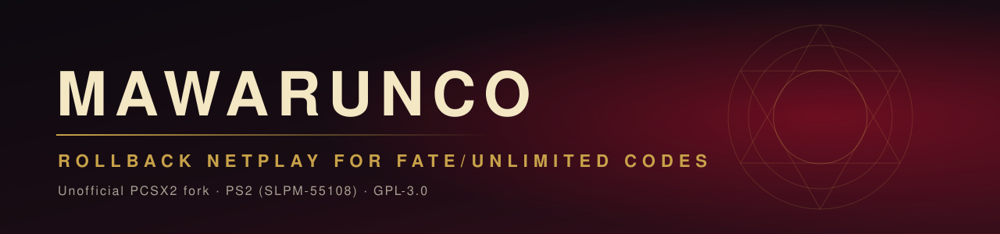

<p align="center">
  
</p>

<p align="center">
  <a href="https://github.com/rmikorow/mawarunco/releases/latest"><b>Download for Windows</b></a>
  &nbsp;·&nbsp;
  <a href="https://rmikorow.github.io/mawarunco/">Website</a>
  &nbsp;·&nbsp;
  <a href="#security-and-transparency">Security</a>
  &nbsp;·&nbsp;
  <a href="#building-windows">Build it yourself</a>
</p>

**Mawarunco** brings rollback netplay to **Fate/unlimited codes** (PS2,
SLPM-55108). It is an unofficial fork of the PS2 emulator
[PCSX2](https://github.com/PCSX2/pcsx2) v2.8.2.

> Mawarunco is **not affiliated with or supported by the PCSX2 team**. Please
> do not report problems with it to the PCSX2 project. Fate/unlimited codes is
> a trademark of its owners; this project is not affiliated with Capcom,
> TYPE-MOON or cavia.

This repository contains **only source code**: no BIOS, no disc image, no game
executable and no game data. You need your own PS2 BIOS and your own copy of
the game.

## Features

| | |
|---|---|
| **Rollback netplay** | Direct connection, no VPN. The host forwards one UDP port; joining needs nothing. The host decides input delay (0–8) and rollback depth (1–8). Built on [GGRS](https://github.com/gschup/ggrs). |
| **Rooms** | A list of open rooms in the start window: create a room (open or with a code), or join one with a click. No typing of IP addresses; the list never shows them. |
| **Low input latency** | Input-to-screen latency went from 33.6 ms to 10.6 ms: each frame is presented before the frame limiter sleeps, and 1 frame of run-ahead hides the game's internal lag. Run-ahead works offline and online. |
| **No shared savestates** | Each player boots their own copy, straight to the character select of *Vs. 2P* or *Practice*, with all characters unlocked. |
| **Your button config everywhere** | The game's own button config, set once in the start window: click an action, press the button. You keep your layout as player 1 or player 2. |
| **Player names** | Shown above the health bar next to the win counter, e.g. `MAWARU / 2WINS`. |
| **Start window** | Online, training, button config and display: 4:3 resolutions, window or fullscreen. |
| **Installer** | Per user, no admin rights. It asks for your BIOS and disc image, and updates keep your settings. |
| **Desync diagnostics** | Checksums every second; on a desync both sides log per-block memory hashes, so the cause can be found. |

## Getting started

1. Download **`Mawarunco-Setup-v<version>.exe`** from the
   [latest release](https://github.com/rmikorow/mawarunco/releases/latest) and
   run it. Choose your PS2 BIOS file and your disc image of Fate/unlimited
   codes.
2. Start **Mawarunco**. Under *Button config*, set up your controller and
   buttons; under *Online*, enter your name.
3. Play, under *Online*:
   - **Rooms:** click *CREATE ROOM* (optionally with a code), or pick a room
     from the list and click *JOIN ROOM*.
   - **Direct (IP):** the host clicks *HOST* and tells the other player their
     public IP address; the other player enters it and clicks *JOIN*.
   - Hosting needs UDP port 7000 forwarded in the router, with rooms too.

Both players need the same Mawarunco version and the same BIOS version.
Windows SmartScreen may warn because the files are not signed ("More info" →
"Run anyway"). Each release lists SHA-256 checksums for every file.

## Security and transparency

This repository is public so that anyone can check what the program does.

- **Network:** two parts were added, netplay and the room list.
- **Netplay:**
  - Active only during an online session.
  - It opens one UDP port: 7000 on the host; any free port when joining.
  - Over it go a short handshake (program version, input delay, rollback
    depth) and then GGRS messages, which carry controller input (18 bytes
    per player and frame) and checksums.
  - Received input is only used as button and stick values. It never
    becomes a memory address, file name or command. Packets are decoded
    with a size limit; a host turns away connections from other versions
    or other programs and keeps waiting.
  - Code: [`3rdparty/ggrs-capi/src/lib.rs`](3rdparty/ggrs-capi/src/lib.rs)
    (socket, handshake), [`pcsx2/Rollback/Netplay.cpp`](pcsx2/Rollback/Netplay.cpp)
    (session, input handshake for button config and names).
- **Room list (lobby):**
  - Used only while the online page is open or you host a room. HTTPS only,
    certificates are checked; the server refuses plain HTTP.
  - The launcher sends: program version, your player name, the country you
    chose (optional), input delay, rollback depth, port and a room code if
    you set one. The lobby sees your IP address like any web server.
  - The list shows names and settings, never IP addresses. A host's address
    goes only to the one player who joins (with the right code, if set).
    The address is stored encrypted and deleted with the room, at the
    latest 30 seconds after the host leaves.
  - Everything the lobby sends is checked against a fixed format; the
    launcher only uses names, numbers and one IPv4 address from it.
  - Code: [`pcsx2-qt/LobbyClient.cpp`](pcsx2-qt/LobbyClient.cpp) (client),
    [`tools/rollback/lobby/api.php`](tools/rollback/lobby/api.php) (server).
- **Nothing is downloaded or started:** no other programs, no registry
  changes, no autostart. The PCSX2 auto updater is off
  ([`pcsx2-qt/AutoUpdaterDialog.cpp`](pcsx2-qt/AutoUpdaterDialog.cpp)).
  PINE, PCSX2's local memory-access interface, is off in the player
  package.
- **Files:** besides PCSX2's usual folders (settings, logs, memory cards),
  the program writes only diagnostic dumps and a performance report per
  session (`logs/perf-*.txt`: PC, timings, memory; no addresses, paths or
  names) into its own `logs` folder.
  The start window copies the BIOS you choose into the `bios` folder.
- **Game memory changes:**
  - The boot shortcut and the game features write a few values into
    emulated PS2 memory: character unlock flags, the button config, and a
    small HUD routine for player names. That routine is MIPS code for the
    emulated PS2, not for your PC.
  - Code: [`BootShortcut.cpp`](pcsx2/Rollback/BootShortcut.cpp),
    [`FucButtons.cpp`](pcsx2/Rollback/FucButtons.cpp),
    [`FucNames.cpp`](pcsx2/Rollback/FucNames.cpp).
- **Releases:** every release is built from a tagged commit of this
  repository, and SHA-256 checksums are published with it.

## What changed compared with PCSX2

All changes are on the `rollback` branch, on top of PCSX2 v2.8.2. The commit
messages explain each one.

- [`pcsx2/Rollback/`](pcsx2/Rollback): rollback core, netplay, run-ahead,
  latency measurement, determinism self-test, boot shortcut, game features.
  - The rollback core takes in-memory snapshots in about 1.5 ms and restores
    them in about 2 ms, bit-identical on replay.
  - About a dozen determinism problems in emulation and savestates were
    fixed for that.
- [`3rdparty/ggrs-capi/`](3rdparty/ggrs-capi): small C wrapper around GGRS
  (Rust).
- [`pcsx2-qt/RollbackLauncher.*`](pcsx2-qt): the start window;
  [`pcsx2-qt/LobbyClient.*`](pcsx2-qt): its room list client.
- [`tools/rollback/lobby/`](tools/rollback/lobby): the lobby server (PHP).
- [`tools/rollback/`](tools/rollback): package, patch and installer scripts.
- The PCSX2 auto updater is disabled: it would replace this build with an
  official release.

## Building (Windows)

Same as PCSX2, plus a Rust toolchain:

1. Dependencies: `.github/workflows/scripts/windows/build-dependencies.bat`.
2. Rust: a normal [rustup](https://rustup.rs) install (`cargo` on PATH), or set
   `RollbackRustDir` in an untracked `3rdparty/ggrs-capi/ggrs-capi.local.props`.
3. `msbuild PCSX2_qt.sln "/p:Configuration=Release Clang" /p:Platform=x64`.
4. Package, patch and installer (Inno Setup 6 needed for the installer):
   `tools/rollback/make-netplay-package.ps1 -ReferenceBios <bios> -Update -Installer`.
5. Before a release, the soak test runs training and the netplay sync test
   for a few minutes each and fails on memory growth or slowing frames:
   `tools/rollback/perf-soak.ps1 -Iso <disc image>`.

The build is named `pcsx2-qtx64-clang.exe` like upstream; the package script
names it `Mawarunco.exe` for players. The command line also works for testing:

```
pcsx2-qtx64-clang.exe -batch -netplay "host=7000,delay=1,rollback=2,boot" -- game.iso
pcsx2-qtx64-clang.exe -batch -netplay "join=<host ip>:7000,delay=1,rollback=2,boot" -- game.iso
```

## How it was made

Mawarunco was developed with the help of an AI coding assistant (Claude, by
Anthropic). Every commit made this way is marked "(AI-assisted)".

## License and credits

GPL-3.0-or-later, like PCSX2. All credit for the emulator goes to the
[PCSX2 team](https://github.com/PCSX2/pcsx2); their original README is kept
as [README-PCSX2.md](README-PCSX2.md). The GGRS wrapper in
`3rdparty/ggrs-capi` is MIT OR Apache-2.0, like GGRS.
